<!-- Encabezado -->
<p align="center">
  
</p>

<p align="center">
  <a href="https://github.com/hermes2324">
    
  </a>
</p>

<p align="center">
  
  
  
</p>

---

## 🙋‍♂️ Sobre mí

Soy **Hermes Francisco Verdugo Gómez**, estudiante de **Ingeniería en Sistemas Computacionales** en el **TecNM Campus Guasave**, Sinaloa.
Hago mi **residencia profesional en la Comisión Federal de Electricidad (CFE)**, donde desarrollo herramientas que pasan procesos de papel a lo digital.

- ⚡ Trabajo en apps que se usan en campo y en oficina dentro de CFE
- 📱 Me gusta construir cosas útiles de punta a punta: interfaz, datos y PDF final
- 🌱 Ahora mismo aprendo más de **Kotlin** y **Jetpack Compose**
- 📫 Escríbeme a **[hermesverdugo23@gmail.com](mailto:hermesverdugo23@gmail.com)**

---

## 🛠️ Tecnologías

<p align="center">
  
  <br />
  
</p>

---

## 🚀 Proyectos destacados

### ⚡ RIM360 · Riesgos Identificados en la Maniobra

> App para **CFE División de Distribución, Zona Guasave** que digitaliza el **Formato RIM**, el análisis de riesgos que llena la cuadrilla antes de cada maniobra en líneas y equipos eléctricos.

<p align="center">
  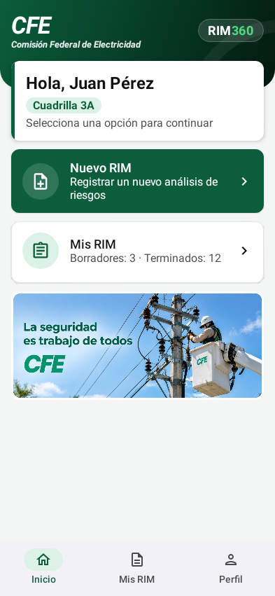
  &nbsp;
  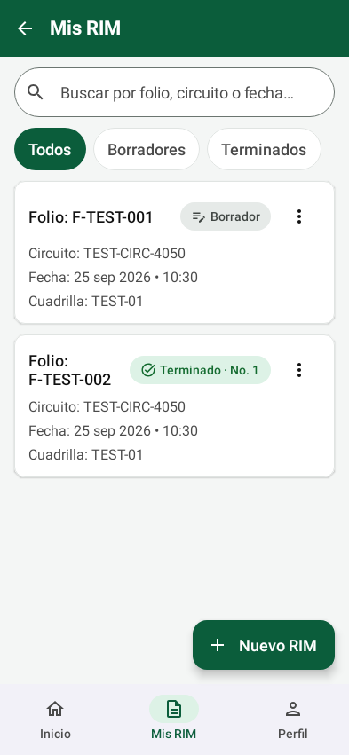
  &nbsp;
  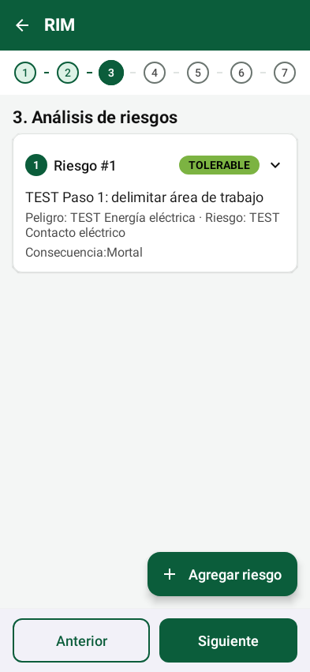
  &nbsp;
  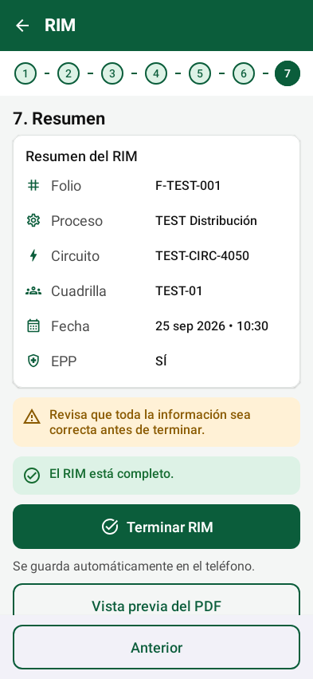
</p>

- 📶 Funciona **sin internet**, con autoguardado de cada paso
- ✍️ Formulario de 7 pasos con **firmas manuscritas** de toda la cuadrilla y fotos
- 📄 Genera un **PDF idéntico a la hoja física** y lo **envía por WhatsApp** al supervisor
- 📱 App **Android** nativa y **app web (PWA)** para iPhone, con la misma configuración compartida

<p>
  
  
  
  
  
  
</p>

<br />

### 🛡️ Presidio CFE · Versiones públicas de expedientes

> Herramienta de escritorio que genera **versiones públicas de expedientes PDF** de comisiones y viáticos de CFE: oculta ("testa") solo los datos fiscales y personales autorizados y conserva todo lo demás.

```text
PDF ─▶ texto digital + OCR ─▶ clasificación por página ─▶ detección de datos
    ─▶ testado autorizado ─▶ PDF público + traza de auditoría
```

- 🔍 Detecta **UUID, sellos digitales, cadena original, códigos QR y de barras** en facturas y tickets
- 🧾 **Clasifica cada página** (factura, ticket, oficio, informe…) y protege las que deben quedar intactas
- 👀 Revisión humana obligatoria antes de publicar y **traza de auditoría** de cada recuadro testado
- 🔒 Los **archivos originales nunca se modifican**

<p>
  
  
  
  
  
</p>

<sub>🔐 Los dos proyectos son de uso interno de CFE, por eso su código es privado.</sub>
<p>
  
  
  
</p>

<br />

### 🏋️ GymManager · Recepción para gimnasios

> Sistema de escritorio para la **recepción de un gimnasio sin torniquete**: registra socios, vende y renueva membresías, cobra con **ticket térmico de 80 mm** y muestra en una **TV** a los socios cuya membresía está por vencer.

<p align="center">
  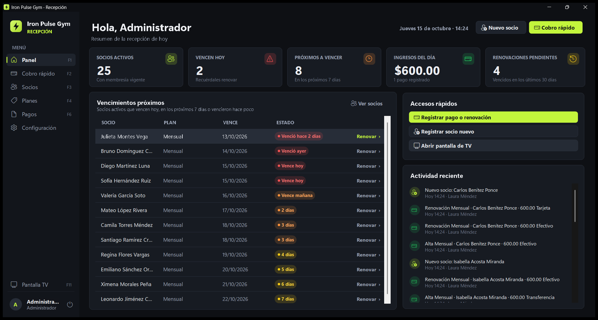
  &nbsp;
  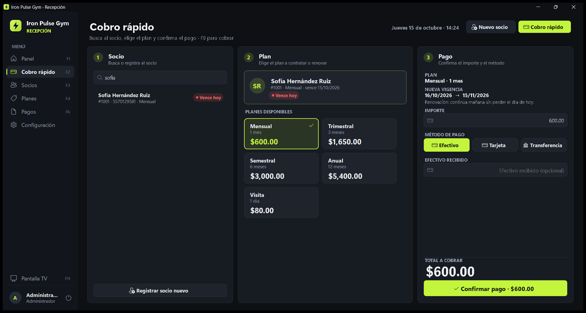
</p>
<p align="center">
  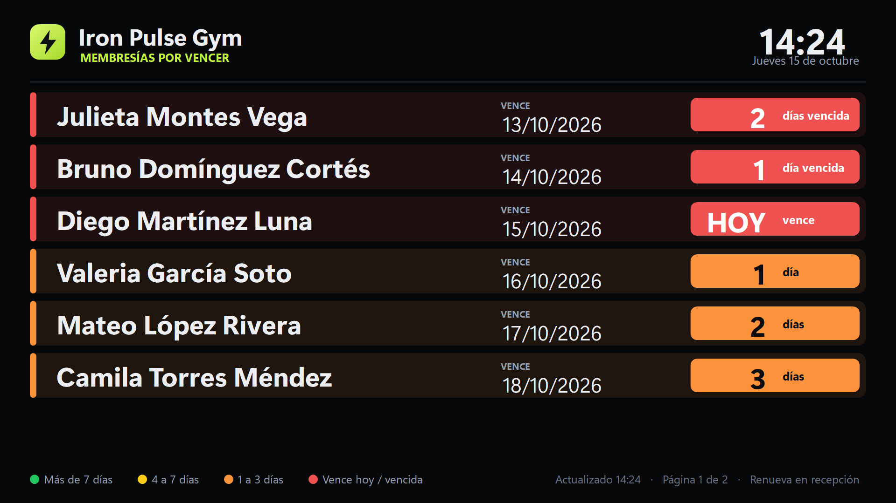
  &nbsp;
  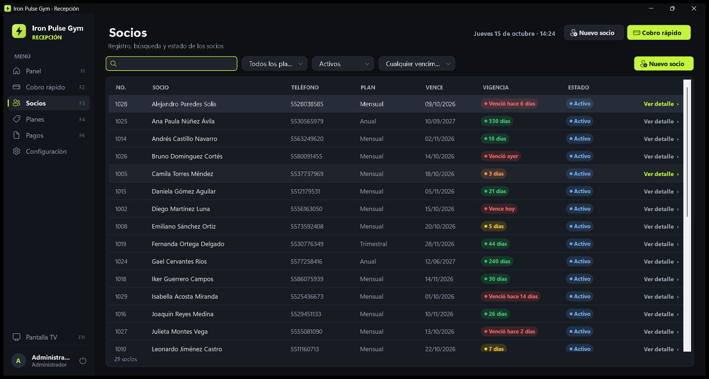
</p>
<p align="center">
  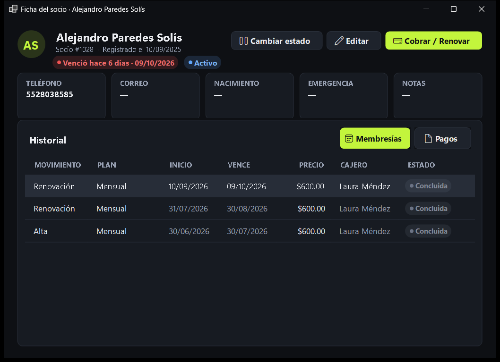
  &nbsp;
  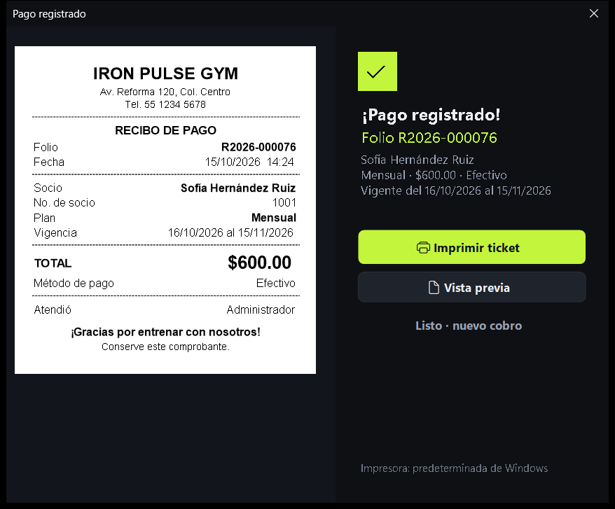
</p>

- ⚡ **Cobro rápido en 3 pasos** (socio → plan → pago): membresía, pago y recibo en **una sola transacción SQL**
- 🚦 **Semáforo de vencimientos** calculado por fecha (verde, amarillo, naranja y rojo) en todas las pantallas
- 📺 **Pantalla de TV** a pantalla completa en un segundo monitor, que se actualiza sola y **sigue encendida en los cambios de turno**
- 🧾 **Ticket térmico de 80 mm** con folio único, vista previa y reimpresión
- 🔒 **Historial inmutable** (los pagos no se editan ni se borran), contraseñas PBKDF2 y **75 pruebas automatizadas**

<p>
  
  
  
  
  
</p>

<sub>🔐 Proyecto comercial: el código es privado. Las capturas usan datos de demostración.</sub>

<br />

### ☕ CafeManager · Punto de venta para cafeterías

> Sistema completo para una cafetería: **caja táctil** para Windows, **pedidos desde el celular escaneando un QR** en la mesa, **pantalla de cocina/barra** y una sola API. Cada cambio llega **en tiempo real** a la caja, a la cocina y al celular del cliente.

<p align="center">
  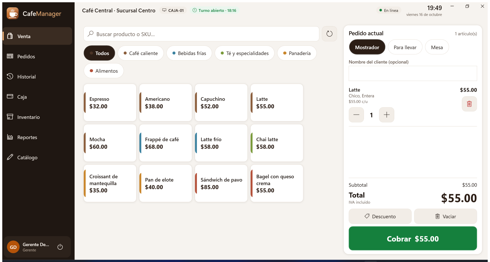
  &nbsp;
  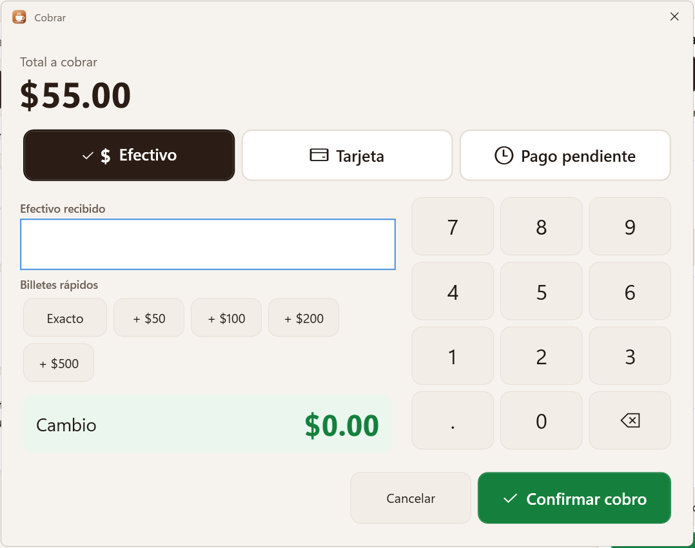
</p>
<p align="center">
  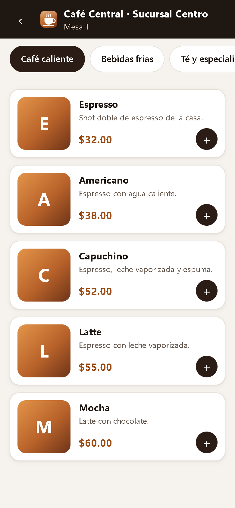
  &nbsp;
  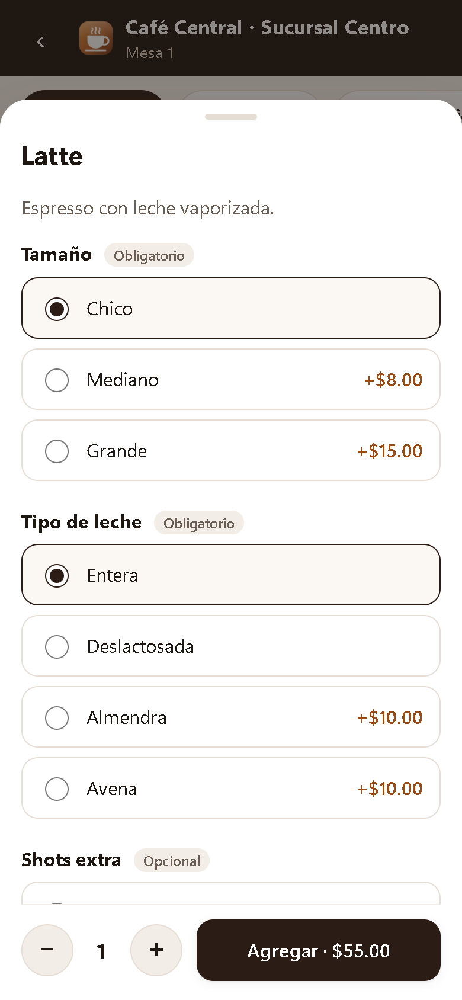
  &nbsp;
  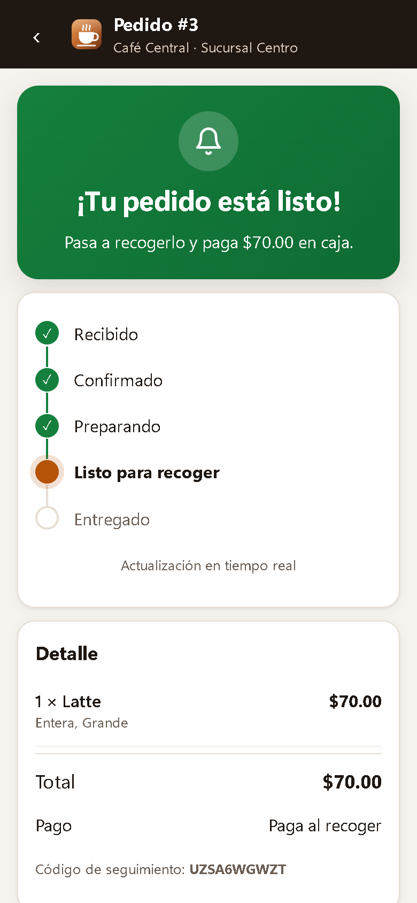
</p>
<p align="center">
  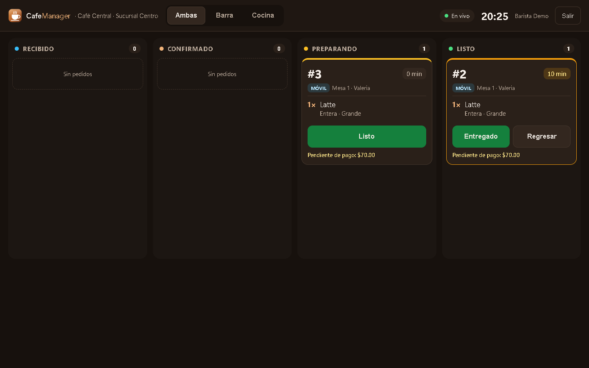
  &nbsp;
  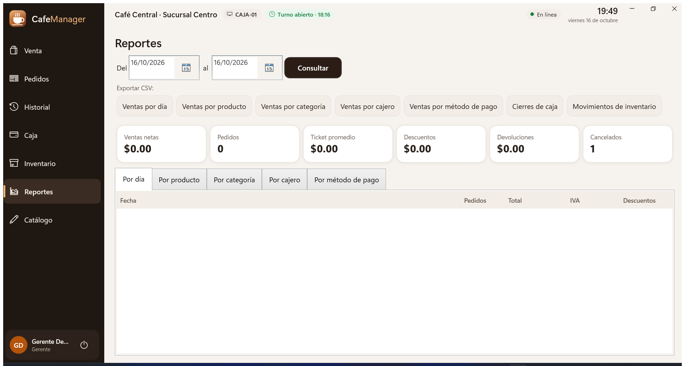
</p>

- 📱 El cliente **escanea el QR, pide y paga al recoger**; su celular le avisa **"¡Tu pedido está listo!"** sin recargar
- 👩‍🍳 **Pantalla de cocina** con columnas por estado y **modo rápido** de un toque cuando una sola persona atiende caja y barra
- 💵 Caja con **modificadores** (tamaño, leche, shots), descuentos autorizados, **arqueo de turno**, inventario por receta y **ticket térmico**
- ☁️ Celular y cocina publicados en **Cloudflare Pages**; la API sale a internet por **Cloudflare Tunnel** sin abrir puertos
- 🔒 **Licencias firmadas (ECDSA)**, auditoría de seguridad, JWT con tokens rotativos y **88 pruebas automatizadas**

<p>
  
  
  
  
  
  
  
  
</p>

<sub>🔐 Proyecto comercial: el código es privado. Las capturas usan datos de demostración.</sub>

<br />

### 🧩 Más proyectos

#### 📱 Apps móviles y web

| Proyecto | Qué es | Tecnologías |
|---|---|---|
| 🍗 **Pollo Pollo a Domicilio** <sub>(privado)</sub> | Plataforma de pedidos a domicilio con paneles para cliente, repartidor y administrador, mapa y notificaciones push | JavaScript · Firebase · Google Maps |
| 🍽️ [**Restaurante App**](https://github.com/hermes2324/restaurante-app-maui) | App para pedir en mesa o a domicilio, con roles de cliente, mesero y administrador y avisos en tiempo real | C# · .NET MAUI · Supabase · Firebase |
| 🏟️ [**Estadios de Fútbol**](https://github.com/hermes2324/Estadios-de-futbol) | Estadios en un mapa interactivo, partidos y venta de boletos | C# · .NET MAUI · Supabase · Mapas |
| 🚗 [**Renta de Autos**](https://github.com/hermes2324/renta-de-autos-maui) | Agencia de renta: autos, clientes, rentas con total automático y reporte por fechas | C# · .NET MAUI · MongoDB Atlas |

#### 🖥️ Escritorio

| Proyecto | Qué es | Tecnologías |
|---|---|---|
| 🗄️ [**SGBD Multiconexiones**](https://github.com/hermes2324/SGBD-MULTICONEXIONES) | Un solo gestor para conectarse a SQL Server, MySQL, PostgreSQL, Oracle y Firebird | C# · Windows Forms · ADO.NET |
| 🛒 [**Sistema de Ventas**](https://github.com/hermes2324/sistema-de-ventas) | Punto de venta con inventario, proveedores, ventas con IVA y gráficas | C# · Windows Forms · SQL Server |
| 📚 [**Biblioteca La Trinidad**](https://github.com/hermes2324/biblioteca-la-trinidad) | Libros, préstamos, devoluciones e inventario; la versión 2.0 agrega reportes con gráficas y PDF | C# · Windows Forms · SQL Server |
| 🐾 [**Veterinaria**](https://github.com/hermes2324/Veterinaria) | Registro de mascotas, citas con costo y reportes | C# · Windows Forms · SQL Server |
| 🧑‍💼 [**Gestión de Perfiles**](https://github.com/hermes2324/gestion-de-perfiles) | Solicitantes de empleo con foto y CV, con controles redondeados propios | C# · Windows Forms · MongoDB |
| 🃏 [**Blackjack 21**](https://github.com/hermes2324/blackjack-21) | El clásico 21 contra la computadora | C# · Windows Forms |

#### ⚙️ Automatización

| Proyecto | Qué es | Tecnologías |
|---|---|---|
| 📄 **Oficios de Retardos** <sub>(privado · CFE)</sub> | Lee el reporte de SIRH desde Outlook y genera automáticamente un oficio Word por trabajador | Python · Outlook · python-docx |

---

## 🐍 Mi actividad

<p align="center">
  <picture>
    <source media="(prefers-color-scheme: dark)" srcset="https://raw.githubusercontent.com/hermes2324/hermes2324/output/github-snake-dark.svg" />
    
  </picture>
</p>

---

## 📫 Contacto

<p align="center">
  <a href="mailto:hermesverdugo23@gmail.com">
    
  </a>
</p>

<p align="center">
  
</p>
